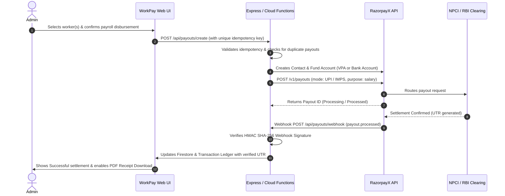

# WorkPay – Worker Shift, Overtime & Payroll Management Platform

> **"Manage Shifts. Track Overtime. Pay Smarter."**

WorkPay is an enterprise-grade, modern full-stack web application designed for industrial plants, logistics hubs, retail chains, and manufacturing enterprises to manage worker shifts, track attendance, calculate overtime wages with mathematical precision, disburse payments automatically via **RazorpayX Payout API**, and maintain an immutable, tamper-evident audit trail of all transactions.

---

## 🚀 Key Highlights & Architecture

- **Frontend**: React 18 + TypeScript + Vite + Tailwind CSS + Lucide React + Recharts + jsPDF + SheetJS (XLSX).
- **Mobile Native**: Capacitor 8 for Android with native `@capacitor/filesystem` and `@capacitor/share` plugins for direct PDF vouchers and database backups.
- **Backend**: Node.js & Express API Server (`server/`) with RazorpayX Payout Client and Webhook signature verification, plus standalone APK distribution.
- **Database & Architecture**: Local-First 0ms optimistic UI architecture with Google Cloud Firestore remote persistence, multi-tab IndexedDB cache, and background non-blocking sync.
- **Payment Processing**: Full integration with **RazorpayX Payout API** and direct **NPCI UPI Intent & QR Settlement** (Google Pay, PhonePe, Paytm, BHIM).
- **Worker Lending & Khata Ledger**: Integrated lending module to track cash/UPI loans to workers and deduct them flexibly from daily or weekly payouts.
- **Standalone APK Distribution**: Dedicated, unlinked public download page at `/download` to distribute the verified Android APK (`WorkPay.apk`) to employees without exposing the private website.
  - 24x7 Instant **UPI Payouts** directly to worker VPA (e.g. `rajesh@okhdfcbank`).
  - Direct Bank Account transfers via **IMPS / NEFT** with masked account safety.
  - Interactive **UPI Intent & Dynamic QR Code Modal** (Google Pay, PhonePe, Paytm).
  - Strict **Idempotency Safeguard** (`X-Payout-Idempotency`) preventing duplicate payroll transfers.
  - Zero-credential exposure on frontend (all Razorpay keys stay strictly on the backend).
  - Production-grade **Sandbox Simulator Mode**: Works immediately out of the box with zero external configuration needed, while instantly connecting to live RazorpayX when API keys are configured!

---

## 👥 Role-Based Access Control (RBAC)

The application features three distinct personas with a frictionless **1-Click Persona Switcher** in the top navigation bar:

| Feature / Permission | Administrator | Shift Manager | Worker (Employee) |
|---|:---:|:---:|:---:|
| Full Executive Dashboard & Metrics | ✅ | Restricted | ❌ |
| Onboard, Edit & Deactivate Workers | ✅ | View Only | ❌ |
| Assign Single & Bulk Shifts | ✅ | ✅ | ❌ |
| Overlap Prevention Validation | ✅ | ✅ | ❌ |
| Record Attendance (Clock In / Out) | ✅ | ✅ | Self (Clock-In) |
| Overtime Wage Calculations | ✅ | ✅ | View Personal |
| Overtime Approval / Adjustment | ✅ | Submit / Review | ❌ |
| Payroll Cycle Generation (Daily/Weekly/Monthly) | ✅ | ❌ | ❌ |
| RazorpayX Payout Initiation & Settlements | ✅ | ❌ | ❌ |
| Immutable Transaction History & UTR Ledger | ✅ | ❌ | Personal Only |
| Download Official PDF Salary Voucher / Receipt | ✅ | ❌ | ✅ |
| Compliance Audit Log Inspection | ✅ | ❌ | ❌ |
| System Settings & Sandbox Reset | ✅ | ❌ | ❌ |

---

## ⏱️ Automatic Overtime Calculation Engine

WorkPay implements strict business logic for overtime calculation:

$$\text{Regular Hours} = \min(\text{Actual Hours Worked}, \text{Standard Shift Hours})$$

$$\text{Overtime Hours} = \max(0, \text{Actual Hours Worked} - \text{Standard Shift Hours} - \text{Unpaid Breaks})$$

$$\text{Overtime Rate} = \text{Hourly Wage} \times \text{Overtime Multiplier}$$

$$\text{Overtime Wages} = \text{Approved Overtime Hours} \times \text{Overtime Rate}$$

$$\text{Total Net Payable} = \text{Regular Wages} + \text{Overtime Wages} + \text{Bonuses} - \text{Deductions}$$

### Overtime Safety Rules:
1. **Approval Mandatory**: Unapproved overtime hours are strictly quarantined. Overtime is **never calculated into payable payroll** until reviewed and approved by management.
2. **Audit Logging**: Any manual adjustment to hours by a supervisor is permanently recorded in the audit trail with justification notes.
3. **Midnights & Breaks**: Automatically handles night shifts crossing midnight (e.g. 22:00 to 06:00) with configurable unpaid break deductions (15m, 30m, 45m, 60m).

---

## 💳 RazorpayX Automated Payout Workflow



---

## 🛠️ Installation & Getting Started

### 1. Prerequisites
- Node.js version 18 or higher (tested with Node 20 / 22 / 26)
- npm version 9 or higher

### 2. Install All Dependencies
Run the unified installer from the project root:
```bash
npm run install:all
```
*(Or install in root, client, and server individually: `npm install && cd client && npm install && cd ../server && npm install`)*

### 3. Run Development Environment
Start both the backend server (port 5001) and frontend client (port 5173) concurrently:
```bash
npm run dev
```

- **Frontend Application**: [http://localhost:5173](http://localhost:5173)
- **Backend API Server**: [http://localhost:5001](http://localhost:5001)
- **API Health Check**: [http://localhost:5001/api/health](http://localhost:5001/api/health)

---

## ⚙️ Environment Configuration

Create a `.env` file in the root or in `server/` (see `.env.example`):

```bash
# Server Port
PORT=5001

# RazorpayX Payout Credentials (Backend Only)
# Leave empty to run in Sandbox Simulator mode
RAZORPAYX_KEY_ID=rzp_live_or_test_key_here
RAZORPAYX_KEY_SECRET=your_razorpayx_key_secret_here
RAZORPAYX_ACCOUNT_NUMBER=your_razorpayx_business_account_number_here
RAZORPAYX_WEBHOOK_SECRET=your_razorpayx_webhook_secret_here

# Firebase Configuration (Optional - client falls back to persistent storage)
VITE_FIREBASE_API_KEY=your_firebase_api_key
VITE_FIREBASE_AUTH_DOMAIN=your_project.firebaseapp.com
VITE_FIREBASE_PROJECT_ID=your_project_id
VITE_FIREBASE_STORAGE_BUCKET=your_project.appspot.com
VITE_FIREBASE_MESSAGING_SENDER_ID=your_sender_id
VITE_FIREBASE_APP_ID=your_app_id
```

---

## 🧪 Testing Guide

1. **Sign In**:
   - Open [http://localhost:5173](http://localhost:5173).
   - Use the **1-Click Persona buttons** to log in as **Administrator** (`admin@workpay.io`), **Shift Manager** (`manager@workpay.io`), or **Rajesh Kumar Worker** (`rajesh@workpay.io`).
2. **Onboard Worker**:
   - Go to **Employees** -> Click **"Onboard Worker"**.
   - Enter name, department, hourly wage (e.g. ₹200), overtime multiplier (1.5x), and UPI ID (e.g. `worker@upi`).
3. **Assign Shift & Test Overlap**:
   - Go to **Shift Calendar** -> Click **"Assign Shift"**.
   - Try creating two overlapping shifts on the same date for the same worker; observe the real-time overlap validation error!
4. **Attendance & Clock Out Overtime**:
   - Go to **Attendance** -> Record arrival with **Clock In**.
   - Clock out with hours exceeding standard 8 hours -> observe automatic generation of an Overtime Request!
5. **Approve Overtime**:
   - Go to **Overtime Approvals** -> Review and approve the request (or click the edit button to adjust hours with an audit log note).
6. **Generate Payroll & Disburse Payment**:
   - Go to **Payroll Management** -> Click **"Run Payroll Engine"**.
   - Click **"Pay Now"** -> Choose **RazorpayX UPI** or **Direct Bank IMPS** -> Confirm disbursement.
   - Payout settles with generated UTR!
   - Click **"Download PDF"** to get the official branded salary voucher.
7. **Test UPI Intent & QR**:
   - In Payment Processing, select **"UPI Intent & QR"** -> Scan the live QR code with Google Pay or PhonePe.

---

## 📄 License
WorkPay is licensed under the MIT License. Developed for enterprise shift, overtime and payroll management.

